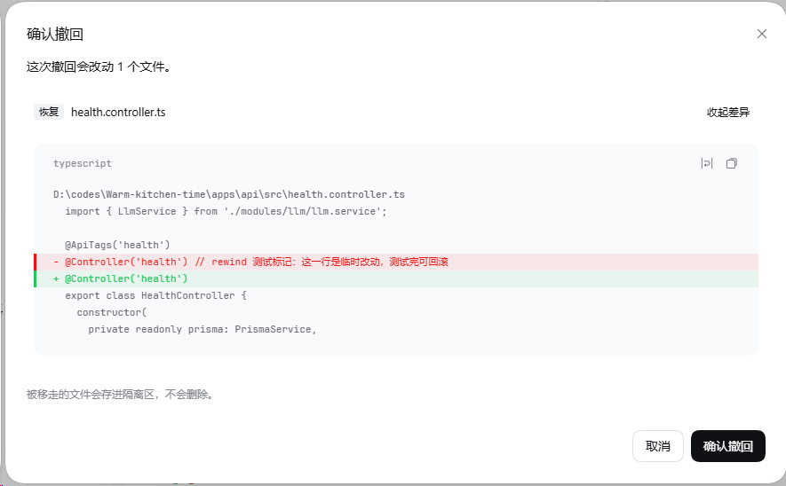

<h1 align="center">dsh-rewind-plugin</h1>

<p align="center">
  
</p>

<p align="center">
  English · <a href="README.zh-CN.md">简体中文</a>
</p>

<p align="center">
  <a href="https://www.npmjs.com/package/@jochenyang/dsh-rewind-plugin"></a>
  <a href="LICENSE"></a>
  <a href="https://github.com/JochenYang/dsh-rewind-plugin/stargazers"></a>
  <a href="https://github.com/JochenYang/dsh-rewind-plugin/issues"></a>
  <a href="https://github.com/deepseek-ai/deepseek-harness"></a>
  <a href="https://github.com/topics/dsh-plugin"></a>
</p>

Message recall for [DeepSeek Harness](https://github.com/deepseek-ai/deepseek-harness): cut the
conversation back to before a message you already sent.

A sent message cannot be edited or withdrawn. This plugin cuts the model-visible surface back to
before a chosen user message, hides that message and everything after it in the transcript, and puts
the original text back in the composer so you can correct it and send it again. Files the recalled
turns changed are put back byte for byte, and every displaced byte is kept in a quarantine you can
look into and clear. A recall that could not cover everything says so instead of claiming a clean
revert.

## See it



The confirmation dialog before a recall: which files the recall will change, a real before/after diff for
each one, and where the bytes that were in the way end up. Nothing is deleted.

## What it adds

| Surface                          | Where                                                                                                               |
|----------------------------------|---------------------------------------------------------------------------------------------------------------------|
| Per-message recall icon          | hover a user message in the transcript                                                                              |
| `/rewind`                        | bare lists the recallable messages; `/rewind <n>` recalls one; `/rewind plan <n>` previews without doing it         |
| Composer prefill                 | the recalled text returns to the input box, once per recall                                                         |
| **Settings → Recall quarantine** | its own page in Settings: every displaced file, grouped by session, discard per row or per session behind a confirm |

The quarantine page registers into `settings.section`, the settings shell's own additive seat, so it
sits beside the shipped General / Models / Plugins pages. A profile without the settings shell loses
the page and nothing else.

A recall stops at the most recent compaction. A compaction replaces the history it summarised with one
checkpoint message, so the prompts before it are no longer on the model-visible surface and the list
cannot offer them. `/rewind` says that: the listing, an out-of-range answer, the picker and the
confirmation dialog all name the boundary instead of showing a shorter list without a reason.

## Install

```sh
# from the registry
dsh plugin --profile web add @jochenyang/dsh-rewind-plugin

# or straight from the release tarball, no registry involved
dsh plugin --profile web add https://github.com/JochenYang/dsh-rewind-plugin/releases/latest/download/dsh-rewind-plugin.tgz

# or from the repository, built on install
dsh plugin --profile web add github:JochenYang/dsh-rewind-plugin
```

`web` is the shipped profile name — use whichever profile you run. Every form writes the package
load it.

**The official desktop client has no command for this.** Its `desktop` profile is reserved for the
Electron application, and the CLI refuses to touch it (`error: profile "desktop" is managed
exclusively by the Electron application`). Install from inside the app instead:
**Settings → Plugins → Add plugin**, enter `@jochenyang/dsh-rewind-plugin` under "Package name or
address", install, and restart the app. That field also takes a Git address, a local directory or a
`.tgz`, and the page says itself that a new plugin loads at the next start.
load it.

`peerDependencies` deliberately declares no `@deepseek-ai/dsh-*` package. The installer compares
every such peer against the running runtime version and refuses the install when it does not match,
which would pin the plugin to one DSH release. This plugin needs nothing installed to run — the
runtime packages below are already present in any DSH profile — so the check is skipped and any
runtime version installs. The tradeoff is deliberate: a DSH release that breaks one of those
interfaces will load the plugin and fail at that call, instead of being refused at install time.

## Why nothing is lost

The session log is append-only and stays the source of truth. A recall appends one event carrying
`surfaceOp: { op: 'replace', startSeq, endSeq }`, so the log keeps every event, and a reader that
ignores surface ops still sees the full transcript.

Files are never unlinked. The bytes in the way move into
`$DSH_HOME/storages/dsh-rewind-plugin/quarantine/<session>/<slot>/` — with a `manifest.json` naming
the original path — before the before-image is written back. A file the recalled range created is
moved there rather than deleted.

A recall has to know what the range started from, so the plugin takes one bounded copy of the
workspace before a turn's first writing tool and stores it content-addressed under
`$DSH_HOME/storages/dsh-rewind-plugin/{trees,blobs}`. That copy is what makes a file a shell command
rewrote restorable: the `write` / `edit` waterfalls still supply the exact before-image for the tools
they see, and where the snapshot covered a path its bytes are the ones that go back.

## For other plugins

A recall changes the transcript and the working tree. A plugin that mirrored a turn — a board, an
archive, a task list — has to put its own state back too, so the host half publishes the
`dsh-rewind-participants` service. Declare it in your `inject`, call
`register({ id, reconcileAfterRewind })`, and every recall runs your participant after the surface
write, in registration order. A participant that throws or misses its 30-second deadline is logged and
skipped — it cannot fail the recall — and the command collects each participant's result under its id
(the file revert's tally is the one that rides the result). The file revert is itself the first
participant, so this is the path the plugin's own feature already uses.

## What it needs at runtime

Resolved from the profile, never bundled:

`@deepseek-ai/cordis`, `@deepseek-ai/dsh-commands`, `@deepseek-ai/dsh-session`,
`@deepseek-ai/dsh-session-projection`, `@deepseek-ai/dsh-llm`, `@deepseek-ai/dsh-home-paths`,
`@deepseek-ai/dsh-client-connection`, `@deepseek-ai/schemastery`, `zod`.

The browser half requires only `react`, `react/jsx-runtime`, `react-dom/client` and
`@deepseek-ai/dsh-client-ui-primitives`, all supplied by the shell's own module table. It does not
list them in `dsh.client.external` because the shell already answers them.

## Operational notes

- **One writer per session.** DSH takes a cross-process exclusive write lock per session, held for
  the life of a write handle. Two DSH processes that share `$DSH_HOME` therefore cannot both write
  the same session: the second one's command execution is refused with `session/writer-held`, and a
  recall reports that the request never reached the kernel. Reading a session from a second instance
  is fine and different sessions never conflict — close it in the other window, or work in another
  session.
- A recall needs an idle agent. A running turn is refused rather than raced, because cutting
  mid-turn would leave that turn's tool results without their call.

## Known limits

- A file changed by a tool this plugin cannot observe — a shell command, a script the model ran, a
  renderer — is covered by the workspace snapshot rather than by the write waterfalls. The snapshot is
  bounded (file count, total bytes, per-file bytes, a deadline, and the tool call's abort signal), so
  a very large tree, an unreadable file, a symlink or a timed-out walk can leave a path out. Every
  recall reports a `coverage` verdict — `full`, `partial` or `none` — with the reason and the writing
  tools involved, so a gap is visible instead of silent.
- Dependency, VCS and cache directories (`node_modules`, `.git`, …) are outside coverage on purpose,
  so a recall that ran `npm install` does not report the dependency tree. Build output such as `dist/`
  IS walked.
- `size` + `mtime` unchanged counts as unchanged. A writer that restores an old mtime at an unchanged
  size is missed — the same bargain every sync tool makes.
- The placeholder is an empty `user/message`. The DeepSeek provider's request path drops an empty
  user message, so it contributes no model-facing turn there; a provider that does not drop empty
  user content would see one extra empty message per recall.

## Development

```sh
npm install
npm run build      # lib/index.js + lib/client.js
npm run typecheck
npm test           # bundles tests/*.test.ts with esbuild, then node --test
```

`npm run build` marks `@deepseek-ai/*`, `@cordisjs/*`, `react`, `react-dom` and `zod` external, and
wraps the browser half in the `window.__ModuleLoader__.load({ id, factory })` closure the web client
loads. Never bundle an `@deepseek-ai/*` package: a second copy breaks class identity against the
running host.

`lib/` is committed, so `dsh plugin add github:JochenYang/dsh-rewind-plugin` installs without a
build step — pnpm refuses to run a git dependency's build script unless the installing profile
allowlists it. Run `npm run build` after changing `src/`; `prepublishOnly` does the same before a
registry release.

## Layout

| Path                                                     | What lives there                                                         |
|----------------------------------------------------------|--------------------------------------------------------------------------|
| `src/index.ts`                                           | the host half: `/rewind`, the write recorder, the snapshot/revert path   |
| `src/cut.ts`                                             | the recall computation — anchors, the replacement range, the placeholder |
| `src/projection.ts`                                      | the `rewindAnchors` projection, the client's whole read face             |
| `src/routes.ts`, `src/quarantine.ts`, `src/snapshots.ts` | the quarantine routes, listing/purge, and the before-images              |
| `src/trees.ts`                                           | the workspace snapshot store and its retention rules                     |
| `src/recorder.ts`                                        | which file change belongs to which turn                                  |
| `src/wire.ts`                                            | the payload shapes and error codes both halves share                     |
| `src/client.ts`                                          | the client half: icon, picker, prefill, hidden turns, the Settings page  |
| `src/client/`                                            | the components, dictionaries and the injected stylesheet                 |
| `cordis.patch.yml`                                       | the one insert row that mounts the plugin                                |

## Changelog

Every release is documented in [CHANGELOG.md](CHANGELOG.md), following
[Keep a Changelog 1.1.0](https://keepachangelog.com/en/1.1.0/). Version numbers follow
[Semantic Versioning 2.0.0](https://semver.org/spec/v2.0.0.html). A Chinese mirror lives in
[CHANGELOG.zh-CN.md](CHANGELOG.zh-CN.md).

## License

[MIT](LICENSE)
